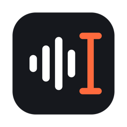

  
  <h1>Speakin</h1>
  
Speak in, type out.

  
  
  

   

  

---

## 功能

- **說完就整理好**：口述的內容馬上整理成通順的文字，貼進你正在打字的地方
- **聲音不上傳**：語音辨識在你的 Mac 上完成
- **自動學習**：記住你常用的字詞和改過的錯字，下次就會寫對
- **智慧建議**：每 7 天用你選的潤稿工具看一次最近講的話，找出常被聽錯的詞，附上是哪幾句講的，你決定要不要加進字典
- **email 和網址用講的**：講「amy at example 點 com」就會寫成 amy@example.com
- **錄音鍵自己選**：Fn 或右邊的 ⌘、⌥、⌃、⇧，沒有 Fn 的外接鍵盤也能用

## 需要什麼

- Apple Silicon（M 系列晶片）的 Mac，macOS 14 以上
- 第一次打開會下載語音辨識模型（約 1.7 GB）
- 想要自動潤稿的話，電腦上要有一個已經登入的 AI 工具：Claude Code、Codex 或 Antigravity。沒有的話，也可以在設定裡下載本機潤稿模型（約 2.7 GB，不用上網，比較慢）

## 開始使用

1. 下載 `Speakin.dmg`，把 Speakin 拖進「應用程式」
2. 打開 Speakin，照著畫面允許麥克風和輔助使用權限
3. 點一下任何輸入框，按錄音鍵開始說話

錄音有三種按法，在設定裡切換：

- **按住講放開結束，或點一下免持**（預設）
- **按一下開始，再按一下結束**
- **按住講，放開結束**

講完想再貼一次，按 `⌥⇧V`。

## 你的資料去哪裡

- **聲音**：只在你的 Mac 上辨識，不會上傳。
- **文字**：開著「自動潤稿」時，辨識出來的文字會交給你選的 AI 工具整理。關掉潤稿或選「本機」，文字就不會離開電腦。
- **智慧建議**：會把最近 7 天的紀錄交給你選的潤稿工具檢查（選「本機」就不離開電腦）。不想要可以在設定裡關掉；關掉自動潤稿時也不會跑。
- **歷史紀錄**：存在你的 Mac 上，可以在設定裡選要留幾天，或完全不存。

## 更新紀錄

每個版本改了什麼，請看 [CHANGELOG.md](CHANGELOG.md)。
